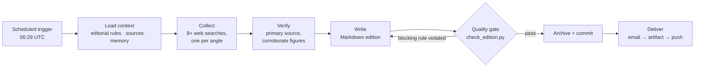

# Signal IA — an autonomous research-and-writing agent

An LLM agent that researches, fact-checks, writes and delivers a daily AI newsletter
with no human in the loop. It has published **every morning since 13 September 2026**:
each run starts from a cold session, reads its own configuration and memory from this
repository, and commits the new edition back to [`editions/`](editions).

> The editions are written by the agent (Claude, run on a schedule). The system around
> it (the prompt, editorial rules, memory, quality gate and email renderer) is my work.

The newsletter itself is in French: 15 to 20 items, about a 7-minute read, covering
models and research, infrastructure and tooling, companies, products and funding, across
the US, China and Europe.

## How a run works



## Engineering decisions

**Rules the model must follow are executable, not just written.** The first three
editions broke rules stated in the prompt: items without a source, the same outlet cited
three times, the figure of the day repeated in the brief. `scripts/check_edition.py` now
encodes the editorial rules and exits with code 1 when a blocking rule is violated, so
the edition is not sent until it is fixed. It checks:

- that every section is present;
- that every item has a source link;
- that no URL is repeated;
- that no outlet supplies too many items;
- that the brief contains at least two technical points;
- that the figure of the day has not been used before;
- how close the topics are to those of the past seven days.

**Memory is derived, never maintained by hand.** `scripts/registry.py` rebuilds the
agent's memory from the archived editions on every run: which companies have already
had a profile, which source domains are over-used, which topics are recent. Because it is
recomputed from what was actually published, it cannot drift out of sync. It prevents
repeats like the one in the first week, when the same product launch was covered twice
in three days.

**Sources are a trust filter.** 57 domains in three trust tiers (primary source,
reference press, community signal) in [`config/sources.yaml`](config/sources.yaml) are
passed to the searches as `allowed_domains`. Any figure has to be traced back to a
primary source and corroborated before it is published.

**Delivery degrades gracefully.** The edition goes out by email if possible, otherwise
as a private page plus a push notification. It is always archived in the repository,
even when every delivery channel fails.

**Built around the environment's constraints.** Outbound network access is closed in
the agent's environment (no RSS, no direct page fetches), so collection goes entirely
through server-side web search. The source catalogue and an egress allowlist are ready
for a switch to RSS collection if access is opened later.

## Repository

```
prompts/daily-brief.md    the agent's instructions for each run
config/editorial.md       editorial line: sections, weights, scope, writing rules
config/sources.yaml       57 sources with trust tiers
config/delivery.md        recipient, schedule, failure behaviour
scripts/check_edition.py  blocking quality gate
scripts/registry.py       memory derived from past editions
scripts/render_email.py   Markdown edition → email-safe HTML
templates/email.html      reference email template
editions/                 one Markdown file per day (the agent's output)
docs/operations.md        operating notes (in French)
```

```bash
python3 scripts/registry.py                               # what the agent remembers
python3 scripts/check_edition.py editions/2026-11-18.md   # run the quality gate
python3 scripts/render_email.py editions/2026-11-18.md --out /tmp/preview.html
```
